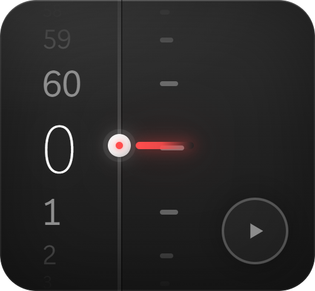
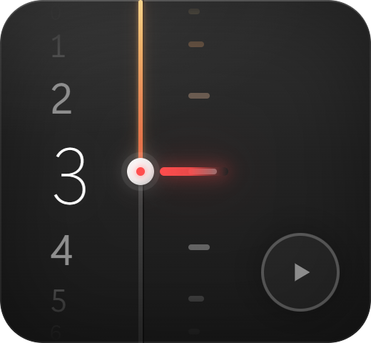

# 倒计时 · TimerCard

一个贴在桌面上的倒计时小卡：滚轮调时间、双击输入、滚起来像真的机械刻度。和 [待办清单](https://github.com/sq907259434/todo-widget)、[天气卡片](https://github.com/sq907259434/weather-widget) 同一套视觉与技术骨架。

| 默认（0 分钟，整条竖线是灰的） | 设了时间（琥珀→红液位点亮） |
|---|---|
|  |  |

## 特性

- **圆柱滚轮**：中间最大、上下逐渐变小变淡，7 格连续渐变；0–60 首尾相接（0 的上面是 60）
- **往下滚是递增**：滚轮向下 = 0→1→2…（与常见滚轮相反，按个人手感定的）
- **数字和刻度一起滚**：滚动时数字带与刻度带同相位平移一格，外围格淡出，松手归位换值
- **液位**：设了时间后，竖线从顶端到圆点是「琥珀→红」的渐变，圆点以上的刻度跟着变暖；0 分钟时整条是灰的
- **日间 / 夜间两套主题**：右键菜单 → 主题 → 跟随系统 / 日间 / 夜间（默认跟随系统）
- **双击改时间**：就地输入分钟数，回车确认 / Esc 取消
- **到点提醒**：整卡红闪 + 三声系统提示音，点一下复位
- **贴进桌面层**：和桌面图标同层，Win+D 不会把它收走
- **桌面快照背景**：磨砂 = 模糊「桌面照片」，可调透明度和磨砂强度

## 用法

| 操作 | 行为 |
|---|---|
| 滚轮 | 调分钟（0–60 循环） |
| 双击数字 | 就地输入 |
| 点播放 | 开始倒计时（显示 mm:ss） |
| 点暂停 | 停住，再点继续；此时可改时间 |
| 左下重置 | 回到设定值，恢复可调 |
| 按住卡片拖动 | 移动位置（位置会记住） |
| 右键 | 预设 5/10/25 分钟、外观、贴进桌面、开机自启 |

## 开发

```bash
npm install
npm start          # 直接跑
npm run dist:dir   # 打包到 dist/win-unpacked（快捷方式指向这里）
npm run icon       # 重新生成图标（tools/make-icon.js + tools/pack-ico.py）
```

**打包前先关掉正在运行的卡片**，否则 exe 被占用，`electron-builder` 会静默失败（exit 0 但 asar 没更新）。打包后 `grep` 一下 asar 里的新字符串确认进去了最稳。

文件分工：

```
main.js            主进程：窗口 / 贴桌面层 / 快照调度 / 拖动 / 输入桥
widget.html        界面全部：布局、CSS、滚轮与动画逻辑
backdrop.js        桌面快照抓取与裁剪
desktop-layer.js   SetParent 进 Progman 那套
ime.html           幽灵输入窗（桌面层里拿不到键盘焦点，靠它代收）
tools/             图标生成
```

## 已知限制

- 桌面层模式下卡片拿不到键盘焦点，所有输入走幽灵输入窗转发，所以没有全局快捷键（除 Ctrl+Alt+2 切回普通窗口）
- 磨砂是「静态照片模糊」，挪桌面图标后需要右键「刷新桌面背景」才同步（换壁纸、改分辨率会自动）
- 只在 Windows 上验证过

## 更新记录

- **1.5.0**：提示音改成卡片内面板（右键「提示音…」打开），**鼠标划过哪一行就试听哪一行**，点一下选中——原生右键菜单没有 hover 事件，做不了这个；面板改全不透明（原来半透明会透出底下的 72px 数字像重影）
- **1.4.0（B 批）**：分/秒单位切换（左上徽标，点击切）+ 分钟上限 99 + 双击输入支持 `3:30` / `90` / `45s` / `2分`，超范围弹一句提示不崩；右上角预设胶囊 5/10/25/自定（悬停或空态显示）；重置与播放并排右下、重置超 10 秒需二次确认；暂停态数字变淡；首用引导一行提示（操作一次或 10 秒后消失，右键可再看）；运行态只留大号数字（72px/600），圆点竖线刻度全部隐去；到点提示音响满 2 分钟自动收声（红闪继续）
- **1.3.0**：数字加粗；液位改成"按格走"（一格 = 中心到相邻数字 53px，0→1 正好一格、3 格顶到上沿）；按住分界线左边上下拖可以拨轮调时间（每跨一格拨一格）；滚轮/拨轮都配"咔哒"声（Web Audio 现场合成）；到点提示音换成自带的 5 版音（右键「提示音」可选 + 试听），系统提示音保留兜底；到点边框加粗成 5~8px 红环
- **1.2.0（P0）**：到点改成系统 toast 通知 + 可循环响铃（右键可切「到点静音」「只响三声」）；计时状态写盘，睡眠/休眠/重启后按结束时间戳重算，期间已到点会立刻提醒并标注「超时 N 分」；运行中保留液位线当进度条（长度 = 剩余/设定），数字移到圆点右侧
- **1.1.0**：加日间（浅色）主题，右键菜单「主题」可选 跟随系统 / 日间 / 夜间；修右键菜单的注册表键（原来和天气卡共用 `WeatherWidget`，两卡互相覆盖），菜单文字改为「显示倒计时卡片」，第一项换成「重置计时」；清掉复制残留（窗口标题、版权、日志路径、注释）
- **1.0.2**：修四个角（`SetParent` 挂进桌面层会清掉窗口区域，现在挂完补设一次、并每 3 秒自检）；刻度中心与数字中心对齐（原来低半个刻度高）；刻度带和数字带用同一套遮罩范围；液位的上端跟着刻度带一起走（滚动时会伸缩）
- **1.0.1**：滚动方向改为「往下滚 = 递增」；刻度带跟随数字一起滚动；0 分钟时不显示液位（整条竖线灰色）；修窗口圆角裁切半径与 CSS 不一致（24 vs 30，四个角会露出多余的一小块）；启动期异常落盘（原来打包版启动失败会静默无日志）
- **1.0.0**：首版
